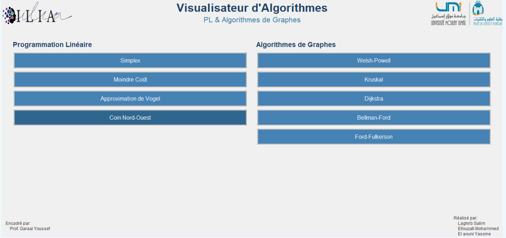
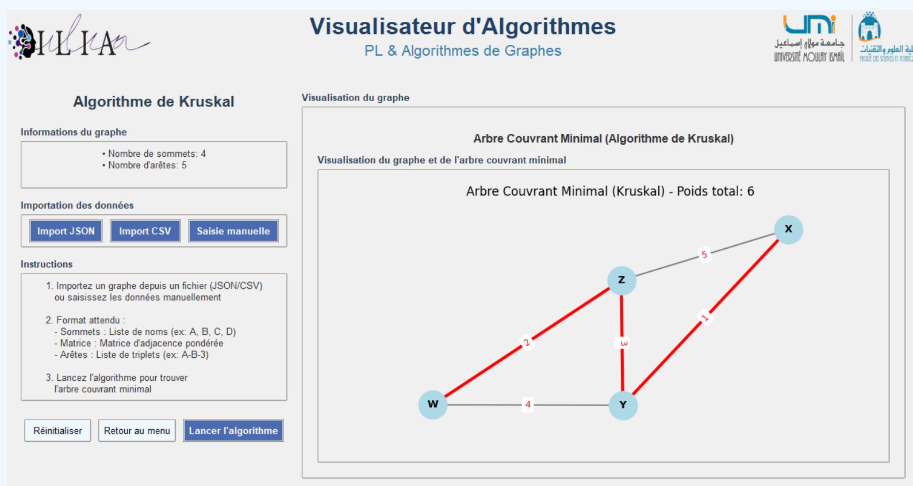
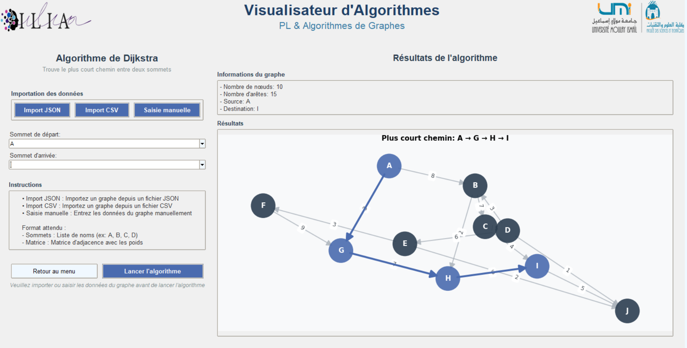
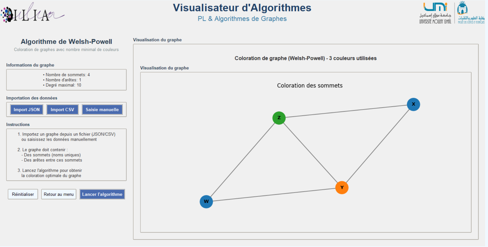
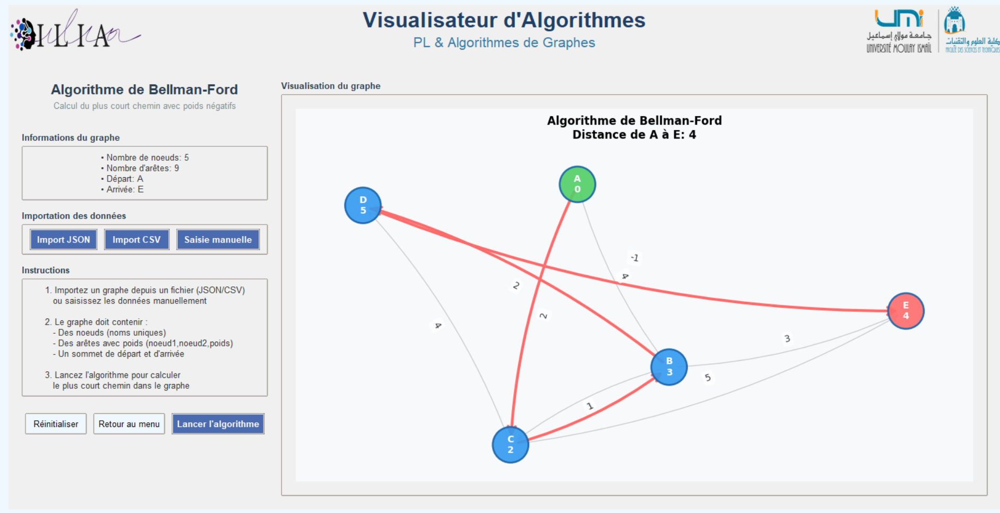

# Algorithm Explorer
### Visualizing Linear Programming & Graph Theory

**Algorithm Explorer** is a Python desktop application designed to make fundamental algorithms in Linear Programming and Graph Theory easier to understand through step-by-step visualizations.

The project provides an interactive learning environment where users can explore algorithm execution, understand optimization techniques, and visualize how graph algorithms solve computational problems.

## Screenshots

### Home Page



### Algorithm Visualizations

| Visualization 1 | Visualization 2 |
|:---:|:---:|
|  |  |

| Visualization 3 | Visualization 4 |
|:---:|:---:|
|  |  |

## Features

- **Interactive desktop interface** for exploring algorithms.
- **Step-by-step visualizations** to understand algorithm execution.
- **Linear Programming** methods for optimization and transportation problems.
- **Graph Theory** algorithms for graph coloring, shortest paths, spanning trees, and network flow.
- **Educational approach** connecting mathematical concepts with practical implementations.

## Algorithms

### Linear Programming & Transportation Problems

| Algorithm | Description |
|---|---|
| Simplex Method | Finds an optimal solution to a linear programming problem. |
| North-West Corner Method | Computes an initial feasible solution for a transportation problem. |
| Least Cost Method | Constructs an initial transportation solution by prioritizing lower-cost cells. |
| Vogel's Approximation Method (VAM) | Uses row and column penalties to estimate an initial transportation solution. |

### Graph Theory

| Algorithm | Description |
|---|---|
| Welsh–Powell | Colors graph vertices using a degree-based ordering strategy. |
| Kruskal's Algorithm | Finds a minimum spanning tree in a weighted graph. |
| Dijkstra's Algorithm | Computes shortest paths from a source vertex when edge weights are non-negative. |
| Bellman–Ford Algorithm | Computes shortest paths and detects reachable negative-weight cycles. |
| Ford–Fulkerson Algorithm | Computes the maximum flow in a flow network. |

## Technologies

- **Python** — core application logic and algorithm implementation.
- **Tkinter** — graphical user interface.
- **Matplotlib** — data visualization.
- **NetworkX** — graph representation and graph operations.

## Getting Started

### Prerequisites

- Python 3.10 or a compatible version.
- Required Python libraries installed in your environment.

### Installation

**1. Clone the repository**

```bash
git clone https://github.com/Ellouzati-Mohammed/Algorithm-Explorer-Visualizing-Linear-Programming-Graph-Theory.git
```

**2. Navigate to the project directory**

```bash
cd Algorithm-Explorer-Visualizing-Linear-Programming-Graph-Theory
```

**3. Create and activate a virtual environment (recommended)**

Windows:

```bash
python -m venv .venv
.venv\Scripts\activate
```

Linux / macOS:

```bash
python3 -m venv .venv
source .venv/bin/activate
```

**4. Install the dependencies**

```bash
pip install matplotlib networkx
```

Install any additional libraries required by the project if necessary.

### Run the Application

From the project root, run:

```bash
python main.py
```

Run the command from the root directory to ensure that Python can resolve the project's packages and modules.

## Project Structure

```text
Algorithm-Explorer-Visualizing-Linear-Programming-Graph-Theory/
│
├── Visualisation/   # Visualization-related modules
├── algorithms/      # Algorithm implementations
├── assets/          # Application assets
├── data/            # Data and input files
├── docs/
│   └── images/      # README screenshots
│       ├── 1.png    # Home page
│       ├── 2.png    # Visualization 1
│       ├── 3.png    # Visualization 2
│       ├── 4.png    # Visualization 3
│       └── 5.png    # Visualization 4
├── gui/
│   └── pages/       # Graphical interface pages
├── test/            # Tests
├── controller.py    # Application controller
└── main.py          # Application entry point
```

## Learning Objectives

- Understand linear programming and optimization methods.
- Compare approaches to transportation problems.
- Explore graph coloring and shortest-path algorithms.
- Understand minimum spanning trees and maximum-flow problems.
- Connect mathematical theory with algorithmic implementation and visualization.


- **GitHub:** [Ellouzati-Mohammed](https://github.com/Ellouzati-Mohammed)
- **LinkedIn:** [mohammed-ellouzati](https://linkedin.com/in/mohammed-ellouzati)

---

*An educational project dedicated to making optimization and graph algorithms easier to explore and understand.*
